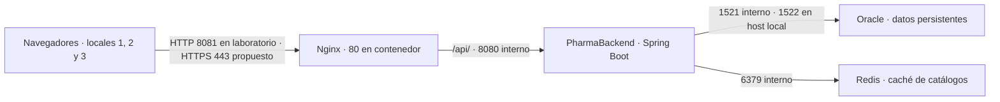

# PharmaSoft · Frontend

Aplicación Angular para catálogos, clientes, ventas y reportes.

Medición de carga inicial: [Parte A](docs/s13-autonoma-parte-a.md). Evidencia completa: [docs/evidencias-s13-autonoma](docs/evidencias-s13-autonoma).

## Despliegue en producción

Nginx sirve Angular y reenvía `/api/` al backend. El navegador usa el mismo origen para la interfaz y el API. Oracle guarda los datos; Redis conserva copias temporales de las lecturas. En laboratorio se ejecutaron Nginx y Redis con Compose, y el backend en el host.

| Variable | Propósito |
|---|---|
| `SPRING_PROFILES_ACTIVE` | Selecciona `prod`, que desactiva Swagger y el SQL detallado. |
| `DB_URL`, `DB_USERNAME`, `DB_PASSWORD` | Conexión JDBC y cuenta de servicio de Oracle. |
| `JWT_SECRET`, `JWT_EXPIRACION_MINUTOS` | Clave de firma gestionada fuera de Git y duración de sesión. |
| `REDIS_HOST`, `REDIS_PORT`, `CACHE_TTL` | Destino de Redis y vigencia del catálogo (10 min por defecto). |
| `SERVER_PORT`, `FRONTEND_ORIGINS` | Puerto interno y orígenes permitidos cuando un cliente usa otro origen. |
| `SPA_DIST` | Ruta absoluta a la carpeta `browser` de la versión Angular que monta Nginx. |

Inyectar los valores con el gestor de secretos del entorno. No reutilizar las credenciales de desarrollo. Para el laboratorio, colocar los dos repositorios como carpetas hermanas.

1. **Construir y conservar la versión.** En backend, con Java 21, ejecutar `.\mvnw.cmd clean verify` con Oracle y Redis de prueba disponibles. Conservar el JAR y su commit. En frontend ejecutar `pnpm install --frozen-lockfile` y `pnpm exec ng build --configuration production --stats-json`. Conservar una copia de `dist/pharma-frontend/browser` por versión.
2. **Desplegar.** En `pharma-frontend/deploy` iniciar Redis con `docker compose up -d redis`. Arrancar el JAR con el perfil y variables de producción. Con `SPA_DIST` apuntando a la nueva versión, ejecutar `docker compose up -d --no-deps web` y `docker compose exec web nginx -t`. Para actualizar, publicar todos los archivos de la versión antes de servir su `index.html`.
3. **Verificar.** Comprobar `/actuator/health`, autenticarse y consultar Productos y Ventas. Recargar una ruta interna; confirmar `index.html: no-cache`, JS/CSS con hash e `immutable` y API con `no-store`. Una cuenta sin permiso debe recibir 403 en métricas.
4. **Revertir.** Si falla el frontend, volver a apuntar `SPA_DIST` a la versión anterior y recrear solo `web` con `docker compose up -d --no-deps --force-recreate web`. Si falla el backend, reiniciar con el JAR anterior y sus variables, previa comprobación de compatibilidad con las migraciones Oracle. Restaurar un respaldo de Oracle solo con un plan aprobado de recuperación. Repetir salud, login y consultas; conservar los archivos con hash de la versión anterior durante la transición.

| Buena práctica de la sesión | Estado local | Acción pendiente |
|---|---|---|
| Medición comparable antes y después | Cumple | Repetir desde la red real de los locales. |
| Features por rutas diferidas | Cumple | Vigilar el paquete inicial en cada cambio. |
| Reporte de Inicio diferido y sujeto a permiso | Cumple | Mantener la prueba vendedor/admin. |
| Entornos separados y presupuestos activos | Cumple | Reducir la advertencia de 57 B del CSS del formulario de venta. |
| Nginx: caché por hash, recarga de rutas y proxy | Cumple | Configurar TLS y conservar la versión anterior durante el cambio. |
| Redis: TTL e invalidación de catálogo y stock | Cumple en la matriz | Repetir la matriz ante nuevas escrituras de catálogo. |
| Si Redis cae, leer desde Oracle y reportar DOWN | Cumple | Alertar por caída y medir latencia de recuperación. |
| Logs con requestId y sin secretos en la muestra | Cumple en la muestra | Automatizar auditoría de logs y revisar rotación. |
| Health público sin detalles; métricas protegidas | Cumple | Monitoreo externo con credenciales de acceso limitado. |
| Perfil prod y secretos por entorno | Cumple en laboratorio | Aprovisionar y rotar secretos propios por ambiente. |
| HTTPS, restauración de Oracle y alertas en sedes | Pendiente | Validar antes de abrir el acceso de los tres locales. |

**Prioridades para los tres locales**

1. **Antes de abrir acceso:** una URL HTTPS común, con renovación automática del certificado. Mantener Oracle, Redis y el backend en red privada.
2. **Antes del piloto:** respaldar Oracle fuera del servidor y practicar una restauración con tiempos medidos. Probar recuperación y reversión con un local antes de abrir los otros dos.
3. **Durante el piloto:** compartir el backend y su Redis privado, medir latencia desde las tres sedes y alertar por DOWN, respuestas 5xx y pérdida de aciertos. Redis puede regenerarse; Oracle es el origen de los datos.

### Evidencia y repetición

Usar datos de prueba en el laboratorio. Los comandos y cifras se describen en el informe S13. Las pruebas de Redis, cabeceras y métricas están en `pharmaSoft-main/tools/s13_autonoma.py`; el script lee las credenciales locales de `S13_ADMIN_USER`, `S13_ADMIN_PASSWORD`, `S13_VENDEDOR_USER` y `S13_VENDEDOR_PASSWORD` o pide la contraseña sin mostrarla. Para comparar precarga, consultar `pharma-frontend/tools/benchmark/README.md`.
