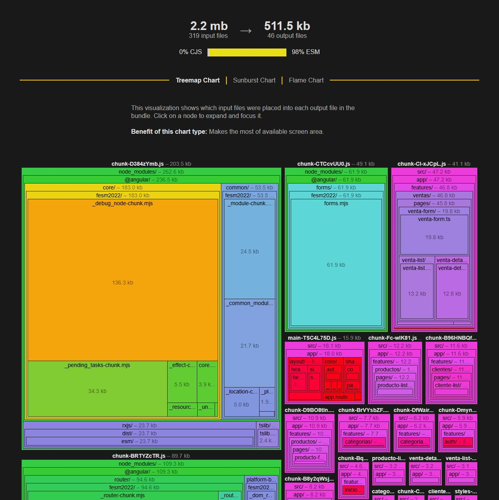
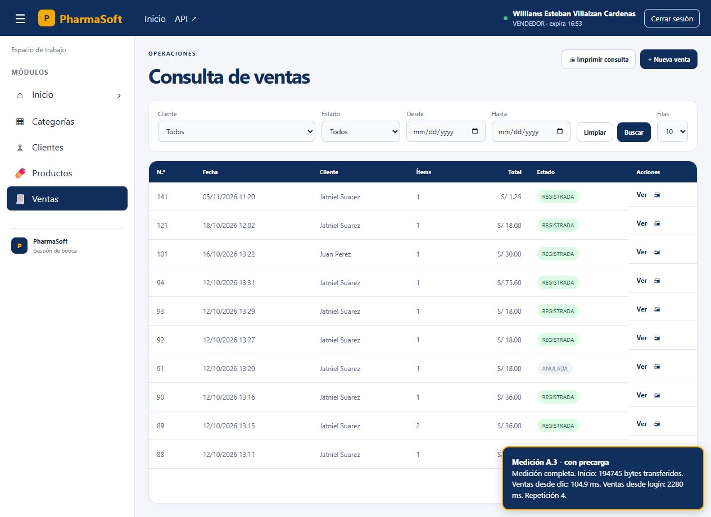

# S13 Autónoma - Parte A: tamaño y carga diferida

Fecha de medición: 8 de noviembre de 2026. Proyecto: PharmaSoft. Estudiante: Jatniel Jair Suarez Vigo.

## A.1. Cinco módulos más pesados del paquete inicial

Se ejecutó una compilación nueva antes de cambiar el código:

```powershell
node node_modules/@angular/cli/bin/ng.js build --stats-json
```

La salida se conserva en `evidencias-s13-autonoma/A/A-antes-build.txt` y el metafile original en `A-antes-stats.json`. Este último se cargó en el analizador oficial https://esbuild.github.io/analyze/.

El analizador utiliza «módulos» para los archivos de entrada que forman los bundles. La tabla usa las contribuciones `bytesInOutput` de los archivos incluidos en el paquete inicial. Se recorrieron las importaciones estáticas desde `src/main.ts` y la hoja global; se excluyeron las aristas `dynamic-import`, que corresponden a pantallas diferidas.

| Archivo / módulo interno | Contribución del metafile (bytes) | kB decimales | Origen / dependencias y uso |
| --- | ---: | ---: | --- |
| `@angular/core/fesm2022/_debug_node-chunk.mjs` | 139534 | 139,53 | Angular Core: ejecución y renderizado de componentes; utiliza otras piezas internas de Core. |
| `@angular/router/fesm2022/_router-chunk.mjs` | 86572 | 86,57 | Angular Router: rutas, navegación y guards; depende de Angular Core y RxJS. |
| `@angular/core/fesm2022/_pending_tasks-chunk.mjs` | 35115 | 35,12 | Angular Core: tareas pendientes, estabilidad y sincronización interna. |
| `@angular/common/fesm2022/_module-chunk.mjs` | 25137 | 25,14 | Infraestructura HTTP de Angular: HttpClient, cabeceras e interceptores; usa Angular Core y RxJS. |
| `@angular/common/fesm2022/_common_module-chunk.mjs` | 22229 | 22,23 | Angular Common: directivas, pipes y utilidades comunes; depende de Angular Core. |

Estos cinco registros son archivos internos de librerías, no cinco paquetes diferentes ni las secciones funcionales del menú. Sus contribuciones son las estimaciones del metafile que usa el analizador; el tamaño final de entrega del paquete inicial se toma de `Initial total` de Angular CLI. No se suman esas contribuciones como si fueran tamaños exactos de archivos finales.

La vista global del analizador incluye también archivos diferidos y auxiliares, por lo que su total no coincide con Initial total. El analizador presenta las cantidades en base 1024; aquí se muestra la contribución en bytes y kB decimales (1000 bytes).



## A.2. Mejora adicional aplicada y medición antes/después

### Qué se encontró

1. `src/app/app.routes.ts` importaba estáticamente MainLayout y AccesoDenegado. El diseño general arrastraba cabecera, menú y aviso de sesión al paquete inicial, aunque la primera pantalla fuera el login.
2. `src/app/features/ventas/ventas.routes.ts` importaba estáticamente VentaList, VentaForm y VentaDetalle. La feature completa era diferida, pero al entrar a consultar ventas se descargaban también el formulario y el detalle.

### Qué se cambió y por qué

- En `src/app/app.routes.ts`, MainLayout y AccesoDenegado usan ahora `loadComponent` con `import()`. El diseño general se descarga cuando se accede a la zona autenticada y la pantalla 403 cuando corresponde.
- En `src/app/features/ventas/ventas.routes.ts`, las tres pantallas usan `loadComponent`. Abrir la lista carga VentaList; el formulario se descarga al abrir Nueva venta y el detalle al seleccionar Ver. Los guards y permisos se conservan.
- El reporte con `@defer` que existía en la práctica S13 se mantuvo. Esta mejora es adicional a ese reporte y a la carga diferida del login ya existente.

Se usó el mismo comando y configuración production para ambas mediciones. Las cifras de «antes» se guardaron antes de editar los archivos.

| Indicador | Antes | Después | Cambio |
| --- | ---: | ---: | ---: |
| Initial total, Raw size | 318,19 kB | 306,91 kB | -11,28 kB (-3,55 %) |
| Initial total, Estimated transfer size | 89,63 kB | 86,58 kB | -3,05 kB (-3,40 %) |
| main generado | 16,27 kB | 4,99 kB | -11,28 kB |
| Chunks JS diferidos | 23 | 29 | +6 archivos diferidos |

El bloque anterior `ventas-routes` pesaba 42,13 kB. Después aparecen por separado `venta-list` (12,21 kB), `venta-form` (18,31 kB) y `venta-detalle` (11,68 kB), además de los pequeños chunks compartidos y de rutas. La división mueve código a descargas posteriores; no elimina funcionalidades ni implica que la suma de toda la aplicación disminuya en la misma proporción.

Compilaciones correctas. Se mantiene un aviso previo de `venta-form.css` (4,06 kB frente a aviso de 4 kB); no supera el límite de error de 8 kB.

Archivos de evidencia: `A-antes-build.txt`, `A-despues-build.txt`, `A-antes-stats.json`, `A-despues-stats.json`, `A-resumen-builds.json` y `A-top5.csv`.

## A.3. Navegación con y sin precarga

### Configuración reproducible

- `src/app/core/routing/route-preloading.ts` exporta una lista vacía de features. Es la configuración normal: carga bajo demanda.
- `src/app/core/routing/route-preloading.all.ts` exporta `withPreloading(PreloadAllModules)`.
- `src/app/app.config.ts` agrega esa lista a `provideRouter`, conservando `withComponentInputBinding`.
- `angular.json` agrega la configuración `preloading` con un reemplazo de archivo. La build normal no incorpora la implementación de precarga global.

Comandos equivalentes para construir las dos variantes:

```powershell
node node_modules/@angular/cli/bin/ng.js build --configuration production --stats-json
node node_modules/@angular/cli/bin/ng.js build --configuration production,preloading --stats-json
```

Para la comparación se generaron copias aisladas bajo `tmp/s13-autonoma` y se sirvieron con Nginx en `localhost:8083` (sin precarga) y `localhost:8084` (con precarga). El despliegue normal de `8081` no contiene la instrumentación.

### Procedimiento y límites de la medición

1. Ambas variantes son la misma versión optimizada; solo cambia la estrategia de precarga. Se utilizaron el mismo navegador integrado, equipo, backend, Redis y usuario vendedor, con viewport 1280 x 720.
2. Los servidores de prueba responden `Cache-Control: no-store` para forzar la descarga de recursos en cada repetición, una condición equivalente a la medición con caché deshabilitada. Gzip está habilitado en ambos.
3. Se realizó un piloto para calentar el backend y validar la instrumentación. Ese piloto (`A-sin-precarga-1.json`) se conserva y no se incluye en las tres repeticiones formales numeradas 2, 3 y 4. El piloto incluía favicon; las repeticiones formales lo excluyen para evitar ruido de solicitudes automáticas.
4. Se comienza en login, se inicia sesión, se espera que Inicio sea visible y se deja una pausa fija de 2000 ms para que opere la precarga. Al terminar esa pausa se registran los bytes acumulados hasta esa primera pantalla y se pulsa el enlace real de Ventas.
5. La instrumentación usa Navigation Timing y Resource Timing del navegador. Los bytes incluyen la entrada HTML, recursos de la aplicación y peticiones del API hasta Inicio; se excluyen el script de medición y favicon. También se conserva la cifra de JS por separado. No se guardan tokens, contraseñas ni cuerpos de respuestas en esta evidencia.
6. Se mide desde el clic hasta el encabezado y hasta la tabla con datos. «Ventas desde login» comprende la autenticación, renderizado de Inicio, pausa controlada y carga de Ventas. Las comprobaciones visuales se realizan cada 50 ms; los tiempos son aproximaciones con esa resolución.
7. Son tres repeticiones locales por variante, sin simular la red de los tres locales. Se reporta la mediana; no se afirma una mejora estadística ni se extrapolan los milisegundos a una conexión WAN.

### Repeticiones observadas

| Estrategia | Repetición | Bytes hasta Inicio | Clic → tabla de Ventas (ms) | Login → tabla de Ventas (ms) |
| --- | ---: | ---: | ---: | ---: |
| Sin precarga | 2 | 141868 | 152,6 | 2322,6 |
| Sin precarga | 3 | 141871 | 246,9 | 2474,7 |
| Sin precarga | 4 | 141871 | 143,5 | 2335,7 |
| Con precarga | 2 | 194749 | 99,7 | 2270,2 |
| Con precarga | 3 | 194748 | 137,6 | 2296,5 |
| Con precarga | 4 | 194745 | 104,9 | 2280,0 |

| Indicador (mediana de 3) | Sin precarga | Con precarga |
| --- | ---: | ---: |
| Bytes acumulados hasta Inicio | 141871 (141,87 kB) | 194748 (194,75 kB) |
| De esos bytes, JavaScript | 139101 | 191977 |
| Clic → encabezado de Ventas | 43,0 ms | 45,7 ms |
| Clic → tabla de Ventas con datos | 152,6 ms | 104,9 ms |
| Login → tabla, incluida pausa de 2 s | 2335,7 ms | 2280,0 ms |

Los bytes reales de esta navegación no son equivalentes a Estimated transfer size del CLI: incluyen más recursos del recorrido y usan la compresión real de Nginx.




### Decisión para la botica

Se mantiene la carga bajo demanda como opción normal. La precarga añadió 52877 bytes hasta Inicio (+37,27 %) y redujo la mediana del tiempo del clic a la tabla en 47,7 ms en el entorno local. El tiempo hasta el encabezado no mostró una mejora clara a la resolución de 50 ms.

Para el local con conexión limitada, priorizar menos descarga al comenzar resulta razonable con estas cifras. En equipos que siempre usan Ventas y cuentan con una conexión estable, la variante de precarga puede ensayarse en la red real. Una posible mejora posterior sería precargar solo las pantallas utilizadas por el perfil, en lugar de todas.

## Verificación funcional y reproducción

Se comprobaron el login, Inicio y la consulta de ventas contra el backend real. También se abrieron Nueva venta y el detalle de la venta 141 tras la separación de rutas: ambas pantallas cargaron sin errores de consola. No se registraron ventas ni se modificaron datos durante esta parte A.

Los scripts y configuración de medición están en `tools/benchmark`. Consultar `tools/benchmark/README.md`. El JSON de cada repetición permite auditar las rutas descargadas, los bytes y la duración. El informe de medianas se conserva en `A-comparacion-precarga.json`.
